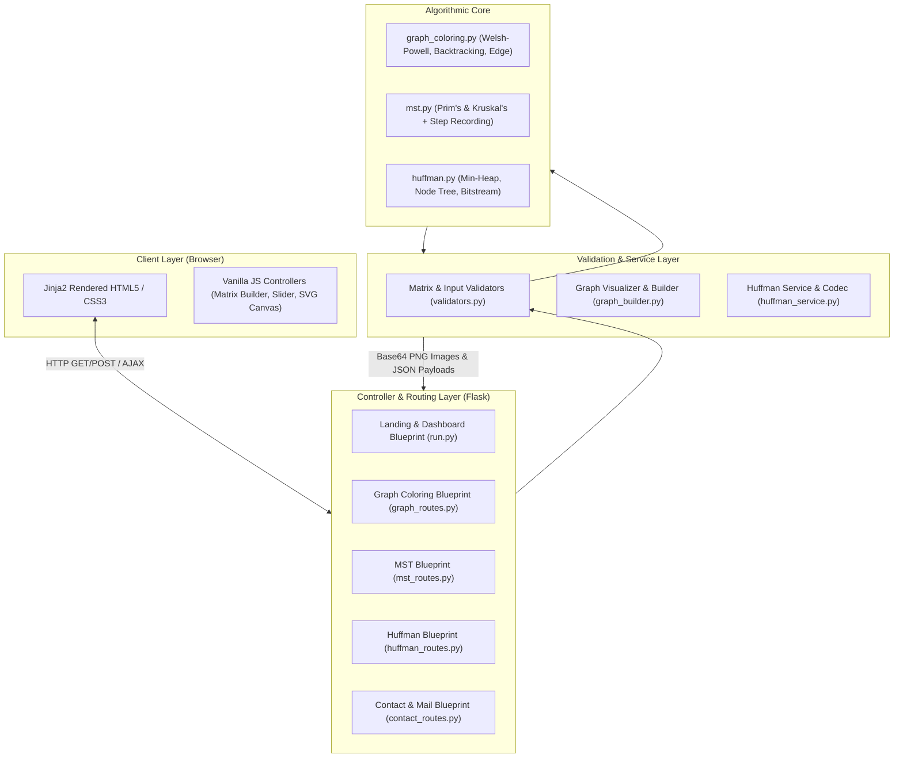

# PROJECT TECHNICAL DOCUMENTATION REPORT
## NEC AlgoViz Pro — Interactive Algorithm Visualization Platform

---

### Document Information
- **Project Title**: NEC AlgoViz Pro
- **Document Type**: Software Requirements & Technical Architecture Specification (SRS / TDD)
- **Domain**: Computer Science / Data Structures & Algorithms / Web Development
- **Version**: 1.0.0
- **Release Status**: Production-Ready
- **Local Endpoint**: `http://127.0.0.1:5000`

---

## 1. Executive Summary / Abstract

**NEC AlgoViz Pro** is an enterprise-grade, web-based educational platform engineered to transform abstract, mathematical algorithms into dynamic, visual representations. Focus areas include **Graph Theory**, **Greedy Optimization**, and **Lossless Data Compression**.

By providing an interactive workbench where users can supply arbitrary adjacency matrices and text strings, the platform demystifies the internal state transitions of NP-complete constraint satisfaction problems (Graph Coloring), greedy spanning tree construction (Prim's and Kruskal's algorithms), and priority-queue-driven prefix coding (Huffman Coding). The system combines a **Python Flask** modular backend with an in-memory **NetworkX / Matplotlib** visual synthesis engine and a responsive, glassmorphic frontend built with **Vanilla CSS3** and **ES6+ JavaScript**.

---

## 2. Problem Statement & Objectives

### 2.1 The Problem
Algorithmic concepts taught in computer science curricula frequently present steep learning curves when explained solely through static pseudocode or whiteboard sketches. In particular:
- **Graph Coloring**: Understanding how heuristic vertex ordering impacts chromatic numbers and why finding optimal chromatic bounds is NP-hard.
- **Minimum Spanning Trees**: Discerning the local greedy vertex selection of Prim’s algorithm versus the global edge-sorting with Disjoint Set Union (DSU) in Kruskal’s algorithm.
- **Huffman Coding**: Visualizing priority queue (min-heap) merges and bitstream binary traversal during prefix-free encoding and decoding.

### 2.2 Primary Objectives
1. **Interactive State Inspection**: Provide step-by-step playback with visual highlighting of active nodes, chosen edges, and queue states.
2. **Arbitrary User Input**: Support custom vertex sizes, weighted adjacency matrices, and arbitrary text inputs with strict mathematical validation.
3. **Zero-Latency In-Memory Generation**: Generate visual frames dynamically on the fly without saving temporary files to disk.
4. **Accessible Enterprise UI**: Deliver a distraction-free, modern SaaS interface with dark/light visual harmony.

---

## 3. Technology Stack Specification

| Layer / Subsystem | Technology | Version | Purpose & Rationale |
| :--- | :--- | :--- | :--- |
| **Backend Runtime** | Python | `3.13.x` | Core execution environment offering high-performance numeric and graph libraries. |
| **Web Framework** | Flask | `3.0.x / 3.1.x` | Lightweight, unopinionated WSGI framework organized via Blueprints. |
| **WSGI Production Server**| Waitress | `3.0.2` | Production-grade, multi-threaded pure-Python WSGI server (8 worker threads). |
| **Graph Modeling** | NetworkX | `3.x` | Graph data structures, adjacency validation, degree calculation, and layout coordinates. |
| **Visual Rendering** | Matplotlib & Pillow | `3.10.x` / `12.1.x` | In-memory plot generation, base64 PNG serialization for zero-disk-write animations. |
| **Template Engine** | Jinja2 | `3.1.x` | Server-rendered HTML templates with custom context processors (`chr` ASCII conversions). |
| **Frontend Styling** | Vanilla CSS3 | Standard | Custom design system: dark navy navigation, glassmorphism, responsive CSS Grid/Flexbox. |
| **Frontend Scripting** | Vanilla JavaScript | ES6+ | Dynamic matrix grid generation, interactive SVG canvas, step-by-step slider engine. |
| **Typography & Icons** | Inter / FontAwesome / Lucide | Web Fonts | Professional, highly legible typography and consistent visual cues. |
| **Messaging & Mail** | Flask-Mail | `0.10.0` | Asynchronous SMTP delivery over TLS (`smtp.gmail.com:587`) for user contact inquiries. |
| **Environment Config** | python-dotenv | `1.2.2` | Isolation of sensitive environment variables, secrets, and SMTP credentials. |

---

## 4. System Architecture & Component Design

The platform follows a clean **Model-View-Controller (MVC) / Blueprint** architectural paradigm.



---

## 5. Detailed Module Functional Specifications

### 5.1 Graph Coloring Module
- **Route Namespace**: `/graph-coloring`
- **Algorithms**:
  1. **Welsh-Powell Algorithm**: Sorts vertices by descending degree; greedily assigns the lowest available color integer such that no two adjacent vertices share colors.
  2. **Chromatic Number ($\chi(G)$)**: Computes the minimum number of colors required to color the vertices.
  3. **Edge Coloring & Chromatic Index ($\chi'(G)$)**: Colors edges using Vizing's theorem bounds.
  4. **Backtracking Exhaustive Search**: Generates all non-isomorphic valid colorings.
  5. **Interactive Manual Coloring**: Provides a canvas where users can assign colors to nodes; the backend validates whether any adjacent nodes violate graph coloring rules.

### 5.2 Minimum Spanning Tree (MST) Module
- **Route Namespace**: `/mst`
- **Algorithms**:
  1. **Prim's Algorithm**: Vertex-centric greedy algorithm. Starting from an initial seed node, continuously extracts the minimum-weight incident edge that expands the connected component without forming cycles.
  2. **Kruskal's Algorithm**: Edge-centric greedy algorithm. Sorts all graph edges globally by weight; repeatedly adds the lowest-weight edge using Disjoint Set Union (Union-Find) with path compression to prevent cycles.
- **Visual Playback Engine**:
  - For each algorithmic iteration, a graph frame is captured.
  - Active nodes are highlighted in red (`#ef4444`), selected tree edges in emerald green (`#10b981`), and remaining candidate edges in muted slate (`#94a3b8`).
  - Users step through iterations using a JavaScript playback controller or auto-play mode.

### 5.3 Huffman Coding Module
- **Route Namespace**: `/huffman`
- **Workflow**:
  1. **Frequency Calculation**: Parses input strings, producing a sorted frequency distribution table.
  2. **Priority Queue Tree Construction**: Constructs a min-heap of leaf nodes. At each step, extracts the two nodes with the lowest frequencies, merges them into an internal parent node with weight equal to their sum, and re-inserts it.
  3. **Code Extraction**: Traverses the resulting binary tree (`0` for left branch, `1` for right branch) to generate prefix-free variable-length binary codes.
  4. **Analytics**: Compares original ASCII byte storage (8 bits/char) against the compressed bitstream to calculate compression ratios and space savings.
  5. **Decoder Utility**: Accepts binary strings and parses them against the active Huffman tree to reconstitute the original plaintext.

---

## 6. Input Validation & Reliability Engineering

To ensure server stability under arbitrary user input, strict validators are enforced prior to computation:

1. **Matrix Structural Validation**:
   - Matrices must be strictly $N \times N$ square structures.
   - Matrices must be symmetric: $M[i][j] = M[j][i]$ for undirected graphs.
   - Non-negativity constraint: $M[i][j] \ge 0$.
   - Self-loops: $M[i][i] = 0$.
2. **SMTP Configuration Health Check**:
   - On server startup, `_validate_mail_config()` inspects all required SMTP credentials.
   - If placeholder values or missing parameters exist, the system logs actionable warning diagnostics without halting the WSGI server.
3. **In-Memory Rendering Performance**:
   - Matplotlib plots are exported directly to memory buffers (`io.BytesIO`) as base64-encoded strings, eliminating file system I/O overhead and race conditions on concurrent requests.

---

## 7. Deployment & Operational Guide

### 7.1 Prerequisites
- Python 3.10+ (Tested on Python 3.13)
- Modern web browser (Chrome, Edge, Firefox, Safari)

### 7.2 Installation & Startup

```bash
# 1. Clone repository and navigate to directory
cd c:\Users\navee\OneDrive\Desktop\it_dsa\NEC-ALGOVIZ

# 2. Install dependencies
pip install -r requirements.txt

# 3. Environment configuration
# Ensure .env exists with SECRET_KEY and optional SMTP mail settings

# 4. Start the application
python run.py
```

### 7.3 Operational Endpoints

- **Landing Portal**: `http://127.0.0.1:5000/`
- **Dashboard**: `http://127.0.0.1:5000/dashboard`
- **Graph Coloring**: `http://127.0.0.1:5000/graph-coloring`
- **MST Module**: `http://127.0.0.1:5000/mst`
- **Huffman Coding**: `http://127.0.0.1:5000/huffman`
- **About Team**: `http://127.0.0.1:5000/about`
- **Contact**: `http://127.0.0.1:5000/contact`
